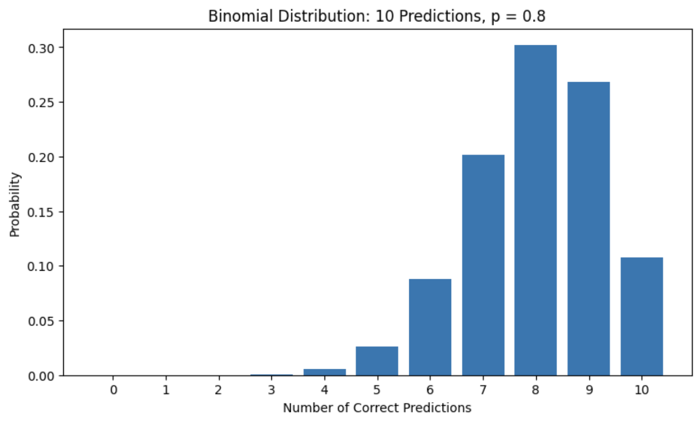

# Bernoulli and Binomial Models for Binary Classifier Outcomes

A Python and Jupyter Notebook exploration of Bernoulli trials and the Binomial distribution, framed around correct and incorrect binary classifier predictions.

The project combines theoretical probability calculations with simulation experiments to examine individual predictions, repeated outcomes, sample-size effects, and long-run convergence.

## Questions Explored

- How can a single binary classifier prediction be modeled as a Bernoulli trial?
- How does the Binomial distribution model the total number of correct predictions?
- What is the probability of observing exactly a selected number of successes?
- How does changing the success probability affect the distribution?
- Why do larger sample sizes produce more stable accuracy estimates?
- How does the empirical average converge toward the theoretical expected value?

## Baseline Experiment

The initial experiment assumes:

- Number of predictions: `n = 10`
- Probability of a correct prediction: `p = 0.80`
- Correct prediction: `1`
- Incorrect prediction: `0`

For this model:

- Expected number of correct predictions: `8.00`
- Variance: `1.60`
- Standard deviation: approximately `1.26`
- Probability of exactly 8 correct predictions: approximately `30.20%`

## Experiments

### 1. Individual Bernoulli Trials

Ten independent binary prediction outcomes are simulated and represented as zeros and ones.

### 2. Exact Binomial Probability

The Binomial probability formula is used to calculate the probability of exactly 8 correct predictions out of 10.

### 3. Full Probability Distribution

The probability of every possible number of correct predictions, from 0 to 10, is calculated and visualized.



### 4. Monte Carlo Simulation

The 10-prediction experiment is repeated 1,000 times. The empirical average is compared with the theoretical expected value.

### 5. Effect of Success Probability

The Binomial distributions for `p = 0.50`, `0.70`, `0.80`, and `0.90` are compared while keeping `n = 10` fixed.

### 6. Effect of Sample Size

The project examines how increasing the number of predictions reduces the standard deviation of the observed accuracy.

### 7. Convergence of the Empirical Mean

A running average across 10,000 repeated experiments demonstrates how long-run empirical behavior stabilizes near the theoretical expected value.

## Key Findings

- A single binary outcome can be modeled with a Bernoulli random variable.
- The number of successes across repeated independent trials follows a Binomial distribution.
- Expected value describes long-run average behavior, not the guaranteed result of one experiment.
- Higher success probabilities shift the distribution toward larger success counts.
- Larger samples provide more stable estimates of the underlying success probability.
- Repeated simulations produce empirical averages close to theoretical expectations.

## Model Assumptions

The basic Binomial model assumes:

- a fixed number of trials;
- two possible outcomes per trial;
- independent trials;
- a constant probability of success.

Real machine learning predictions may not always satisfy the independence and identical-distribution assumptions, so these conditions should be evaluated before applying the model.

## Project Structure

```text
bernoulli-binomial-ml/
├── notebook/
│   └── bernoulli-binomial-ml.ipynb
├── screenshots/
│   ├── bernoulli-single-trials.png
│   ├── binomial-calculation.png
│   ├── binomial-distribution.png
│   └── simulation-vs-theory.png
├── README.md
├── requirements.txt
└── .gitignore
```

## Running the Notebook

Install the dependencies:

```bash
pip install -r requirements.txt
```

Then open:

```text
notebook/bernoulli-binomial-ml.ipynb
```

Run all cells from a fresh kernel to reproduce the calculations and visualizations.

## Technologies

- Python
- NumPy
- Matplotlib
- Jupyter Notebook
